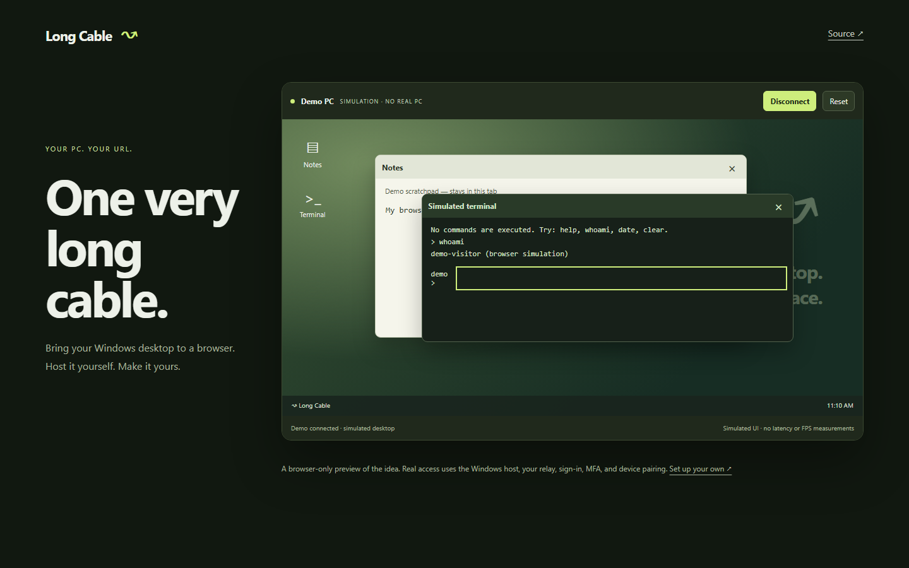
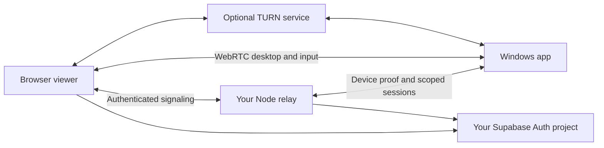

# Long Cable ↝

**Your PC, one very long cable away.**

Self-hosted remote access to your Windows desktop from a browser. The Windows app,
signaling relay, browser viewer, and interactive demo live in this repository.



[](https://github.com/313Wentzy/long-cable/actions/workflows/checks.yml)
[](LICENSE)

## Try it in 30 seconds

Requires Node.js 24+. This simulation needs no install, account, domain or API keys.

```sh
git clone https://github.com/313Wentzy/long-cable.git
cd long-cable
npm run demo
```

Open **http://127.0.0.1:4173**. Connect the demo, drag a window, write a note, and
try the simulated terminal. It runs entirely in your browser: no real PC connection,
command execution, or measured streaming performance.

## The real app

- View and control a paired Windows PC in a browser through WebRTC.
- Select monitors or individual windows; choose 30/60 FPS targets.
- Transfer clipboard text, optionally stream PC audio, and run terminal commands.
- Require owner sign-in, authenticator MFA, fingerprint approval and local enablement.
- Pause control on local takeover; keep device keys in OS-encrypted storage.
- Connect directly where possible, with authenticated TURN fallback for harder networks.

This is an early developer release: **one owner per instance**, not a hosted
multi-user service. Windows lock-screen/UAC secure-desktop control, macOS/Linux
hosts and signed installers are not included. FPS settings are targets; actual
performance depends on hardware and network. It has not received an independent audit.

## Quick start

Actual PC access requires Windows 10/11, Node.js 24+, Rust with the MSVC C++ build
tools, and your own Supabase project for sign-in and MFA.
The [prebuilt Windows app](https://github.com/313Wentzy/long-cable/releases)
lets you skip Rust and the C++ tools: extract its ZIP and run `Long Cable.exe`.
You still need to run and configure your relay. The app is unsigned.

```sh
npm ci
npm run setup
npm start
```

Open **http://127.0.0.1:8790**, sign in with the confirmed owner account you created
in Supabase, and enroll an authenticator when prompted. In another terminal:

```sh
npm run app
```

Click **Pair PC** in the browser. Enter the relay URL and code in the Windows app,
approve the matching fingerprint in the browser, and enable access locally.
Use another device to test control: local input intentionally pauses remote access.

Read the [complete setup guide](docs/setup.md) for authentication, HTTPS,
Cloudflare Tunnel and TURN. A domain and TURN alone are not the complete setup.

## Your infrastructure



Cloudflare Tunnel can expose the local relay without router port forwarding.
TURN is a separate service for WebRTC connectivity; a tunnel alone does not relay
video. A domain is optional locally and for temporary tunnel tests.

The software is MIT licensed. Hosting, domains, authentication and relay bandwidth
can cost money. Cloudflare advertises 1,000 GB/month shared across TURN/SFU, then
$0.05/GB; check [current pricing](https://developers.cloudflare.com/realtime/sfu/platform/pricing/)
before enabling it. Self-hosting requires no subscription to Long Cable.

## One repository

| Path | Purpose |
| --- | --- |
| `apps/desktop-agent` | Electron Windows host and native Rust input broker |
| `apps/relay` | Node service and real browser viewer |
| `apps/relay/public/demo.*` | Isolated browser simulation |
| `scripts/setup.mjs` | Setup wizard; generates local Git-ignored signing keys |
| `docs/setup.md` | Local and public deployment instructions |

You can publish only the demo assets on a static site. The real relay requires
a long-running Node process with WebSocket support. A [Dockerfile](Dockerfile)
is provided. Run exactly one relay process per instance.

## Development

```sh
npm ci
npm run check
npm test
npm run scan
npm run build:windows
```

Packaging creates an unsigned portable Windows ZIP in `apps/desktop-agent/dist`.
`npm ci` downloads Electron; after an install with `--ignore-scripts`, run
`node node_modules/electron/install.js` before launching the app.
CI checks Linux and Windows and compiles the native broker on Windows. Synthetic
and localhost tests do not prove real provider configuration or remote performance.

## Related projects

Remote access is an established field. [RustDesk](https://github.com/rustdesk/rustdesk),
[MeshCentral](https://github.com/Ylianst/MeshCentral) and
[Apache Guacamole](https://guacamole.apache.org/) are useful alternatives.
Long Cable explores a focused personal-PC experience with an inspectable stack.
It does not claim a performance or security advantage over them.

## Contributing

Try it on your own hardware and report reproducible issues without credentials or
pairing state. See [CONTRIBUTING.md](CONTRIBUTING.md) and [SECURITY.md](SECURITY.md).
If this is useful to you, a star helps others find it.
